# Chapter 15: Merchandising

Decide which products shoppers see first. Merchandising rules let you **boost**, **bury**, **hide** or **pin** products whenever a shopper searches for a keyword or opens a category page — for example, put this season's best seller on top for "jacket", push discontinued items to the end, keep a product out of results for a search where it does not belong, or pin a product to an exact position such as #1.

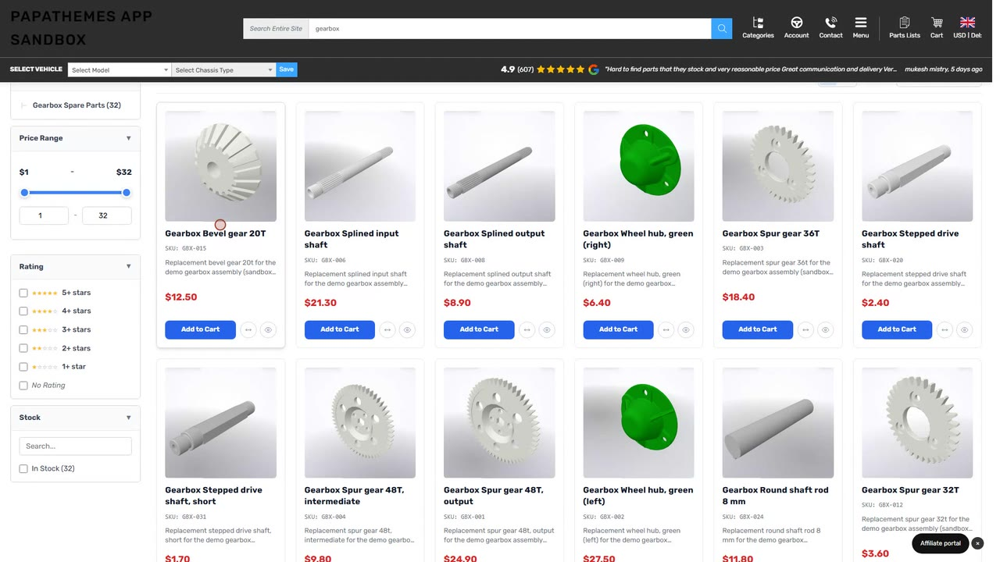

  <iframe src="https://www.youtube.com/embed/UpPdfLjTL-I" title="Merchandising for BigCommerce: Boost, Bury or Hide Products" frameborder="0" allow="accelerometer; autoplay; clipboard-write; encrypted-media; gyroscope; picture-in-picture" allowfullscreen style="position:absolute;top:0;left:0;width:100%;height:100%;"></iframe>

---

## Open the Merchandising Page

From your Dashboard, click the **Merchandising** button. The page lists your rules. Each row describes in one sentence what the rule does, with its trigger, action, target, last update and an on/off switch. You can have up to **200 rules** per storefront channel; the counter above the list shows how many you use.

- Type in **Search rules** to find a rule by name, keyword or category.
- Use the **Trigger**, **Action** (Boost, Bury, Hide or Pin) and **Status** filters to narrow the list.
- Tick several rules to **Activate**, **Pause** or **Delete** them together.
- The **How rules combine** note at the top explains what happens when several rules apply to one product. Close it once you have read it.

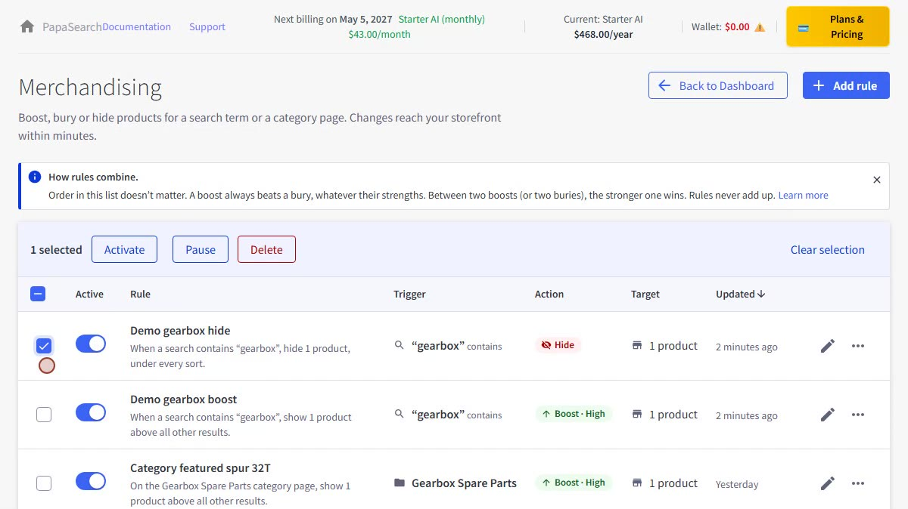

---

## Create a Rule

Click **Add rule**. The rule editor opens as its own page, with a live **Preview** on the right. Fill in:

| Field | What it does |
|---|---|
| **Rule name** | Your own label, shown in the rules list. |
| **When** | **Search keyword** — the rule applies to searches. **Category page** — the rule applies when shoppers open one specific category page. |
| **Keyword** / **Match** | For a search rule. **Contains** applies to any search that includes the keyword (a rule for `light` also applies to "led light bar"). **Exact** applies only when the whole search is the keyword. |
| **Do** | **Boost**, **Bury**, **Hide** or **Pin**. |
| **Strength** | For Boost and Bury: **High**, **Medium** or **Low** (see below). |
| **Which products** | Up to 100 **Products** (search by name or SKU), or whole **Brands**, or **Categories**. Pin rules take up to 20 products, each with a position. |

A sentence at the top of the editor sums up the rule as you build it, for example *When a search contains "gearbox", show 1 product above all other results.* Click **Save rule**. Changes reach your storefront within a few minutes. If you leave the page with unsaved changes, PapaSearch asks before discarding them.

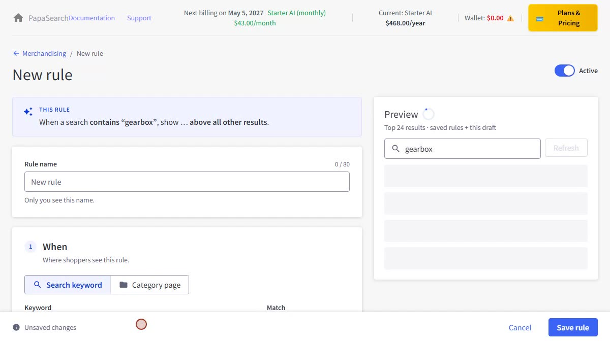

A category page rule applies only when shoppers browse that category. When a shopper searches for a keyword and then filters by that category, only keyword rules apply.

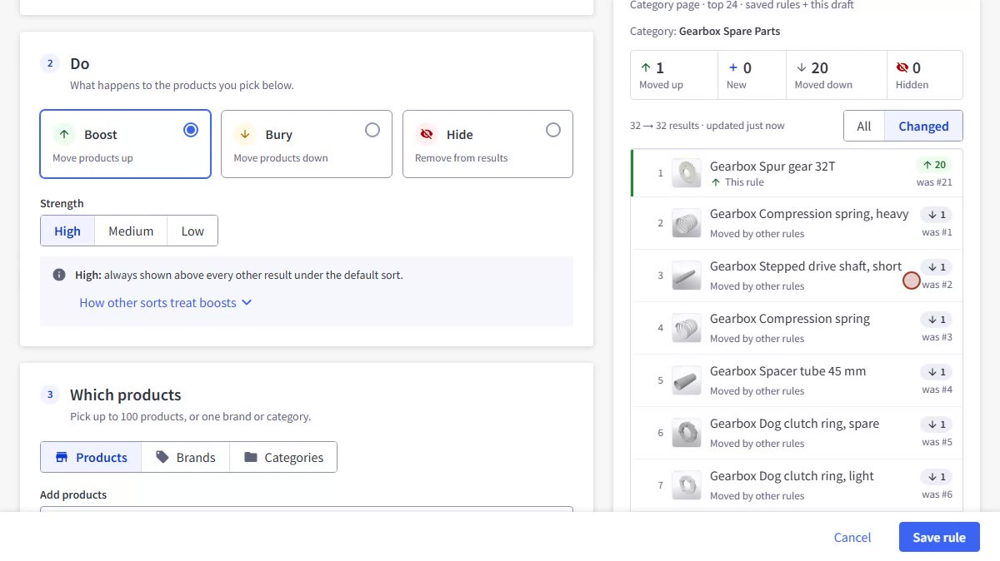

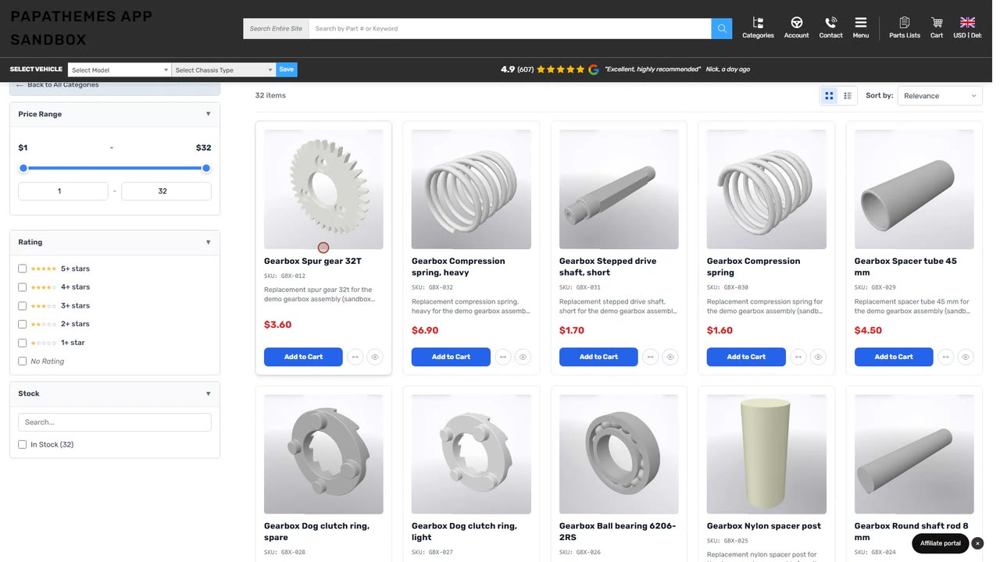

### Choosing categories

Under **Which products → Categories**, each category has a box you click to cycle through three choices:

- **Whole branch** (filled box) — the category and all of its subcategories. The chip shows how many subcategories are included, for example **Shop All +20**.
- **This category only** (outlined box) — only products assigned directly to that category, not to its subcategories.
- **Not selected**.

Categories without subcategories are simply selected or not. A dash on a parent means some of its subcategories are picked. Subcategories inside a whole-branch parent stay clickable: untick one to leave it out, and the parent switches to **This category only** while its other subcategories stay selected. Tick it again and the branch folds back into one choice. Use the arrows to expand or collapse a branch; when you open a rule, only the branches you picked part of are expanded. **Clear all** removes every choice.

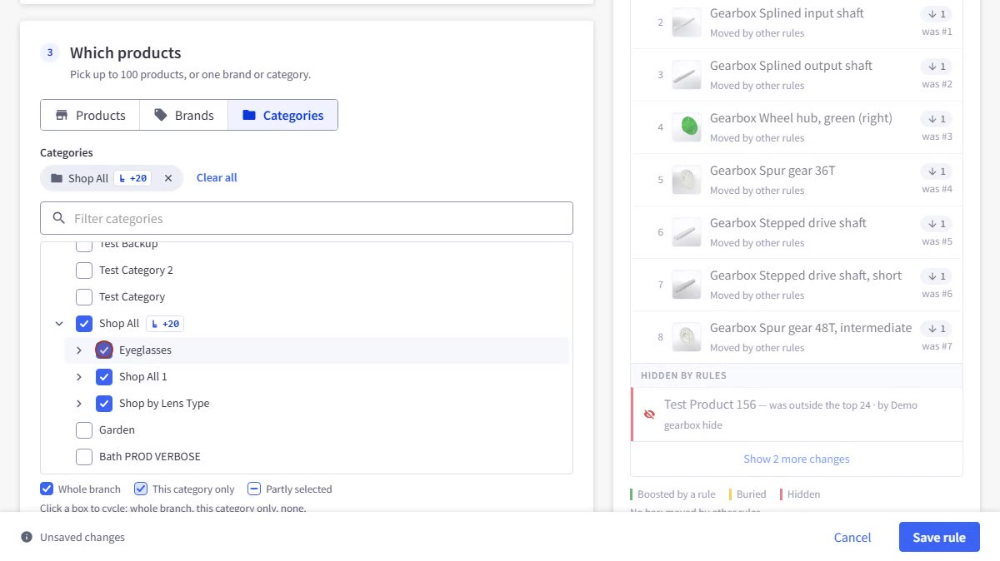

### What each strength does

- **High** — boosted products are shown above all other results; buried products are shown below all other results.
- **Medium** and **Low** — a nudge up or down among results that are about equally relevant. A product that does not match the search well will not jump to the top.
- **Hide** — the product is removed from the results **and** from the filter counts, whatever sort the shopper picks. If a Hide rule removes every result, shoppers see **No products found** instead of the products you hid.

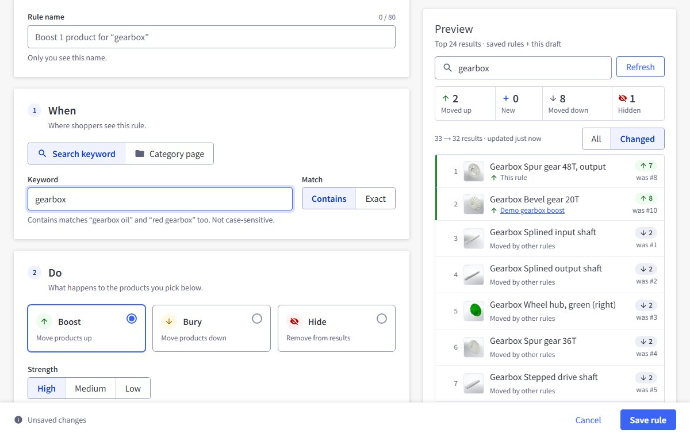

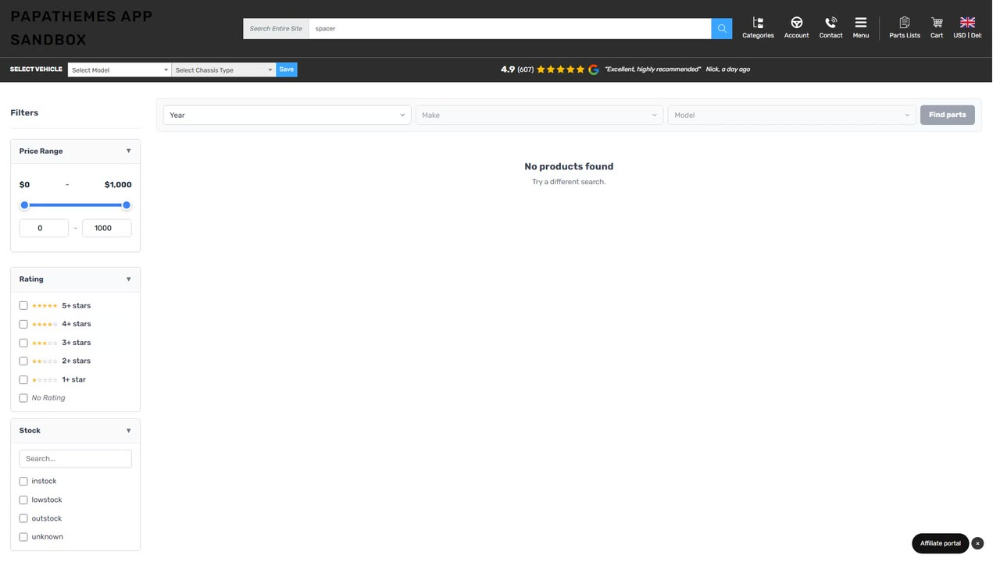

If several rules apply to the same product, they do not add up: a boost always beats a bury, whatever their strengths, and between two boosts (or two buries) the stronger one wins.

### When shoppers change the sort

Boosts and buries follow the default **Relevance** order. When a shopper sorts by **Price**, **Best Selling** or **Top Rated**, the shopper's sort comes first; a boosted product is moved ahead only of products with the same price (or the same sales, or the same star rating), and a buried one behind them. Sorting by **Name** or by date ignores boosts and buries. Hidden products stay hidden under every sort. If **Show out-of-stock products last** is on, out-of-stock products stay at the end even when boosted.

### Order within a rule

When one rule boosts several products, they all move into the top group together, and inside that group they keep their usual relevance order. The order in which you added them to the rule does not matter.

### Keep this order

To show boosted products in an exact order — for example a hero product first, then two accessories — tick **Keep this order** under the product list. It appears for **Boost** rules with strength **High** that target **Products**. The list is numbered: drag a product by its handle, or use the up and down arrows, to set the order. The summary sentence ends with *in the order listed*.

On the storefront these products are shown at the very top, in your order, above other High boosts. If several rules with **Keep this order** apply to the same search, the rule created first comes first; a product that appears in two of them takes its place from the older rule. Like other boosts, the order applies to the default **Relevance** sort; when a shopper picks another sort, that sort comes first. The **Preview** shows the order before you save.

### Pin products at fixed positions

**Pin** puts a product at an exact position in the results — for example a hero product at #1 and an accessory at #3 — while every other result keeps its usual order around them. Choose **Pin** under **Do**, then add up to **20 products** under **Which products**. Each product gets a **Position** box (1 to 100); a new product gets the lowest free position, and you can type another one. Two products in the same rule cannot share a position. The summary sentence reads, for example, *When a search contains "gift", pin Psalm 91 Shield Pendant at #1 and Romans 8:37 Weight Plate at #3.*

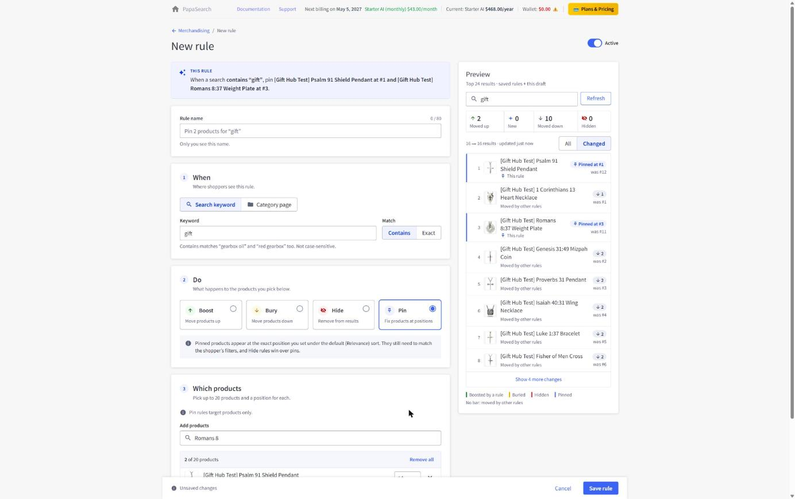

- Pin rules target **Products** only, and have no strength.
- A pinned product does not need to match the search, but it must pass everything else the shopper sees: the category, the filters they picked, visibility and your stock settings. If it does not, its position goes to the next normal result. A **Hide** rule always wins over a pin.
- Pins apply to the default **Relevance** sort, on search and category pages. When a shopper picks another sort, pins are not applied.
- If **Show out-of-stock products last** is on, an out-of-stock pinned product is not pinned.
- If two pin rules claim the same position, the rule created first keeps it and the other product moves to the next free position. A position beyond the last result puts the product at the end of the list.
- Each page still shows the usual number of products, and paging through the results never shows a pinned product twice. Filter counts do not include pins.

The **Preview** marks pinned products with **Pinned at #N**. Pinned products that do not reach the top 24 are listed below it, with their position or the reason they are not shown, for example *Doesn’t match the current filters or category* or *Not in the search index yet*.

### Schedule a rule

To run a rule only for a limited time — a Black Friday boost, a holiday pin, a launch week — fill in the **Schedule** card in the rule editor. Both fields are optional:

| Field | What it does |
|---|---|
| **Start** | The rule turns on at this date and time. Leave empty to start right away. |
| **End** | The rule turns off at this date and time. Leave empty to keep it running until you pause it. |

Times are in your time zone, shown under the fields, for example *Times are in your time zone (America/New_York)*. Click **Clear** next to a field to remove it. **End** must be after **Start**. A time that does not exist or happens twice on the day clocks change for daylight saving is not accepted; pick a time an hour earlier or later.

The summary sentence ends with the schedule, for example *When a search contains "gearbox", show 2 products above all other results, from Nov 20, 9:00 AM.* The rule starts and stops on your storefront on time, without you having to come back — no need to save or clear the cache.

- A schedule works together with the **Active** switch: the rule runs only while it is switched on **and** the current time is between **Start** and **End**. A paused rule does not start on its start date; the editor says so, for example *This rule is paused. It won’t start on Nov 20, 2026, 9:00 AM unless you turn it on.*
- When the end has passed, the editor shows *This rule has already ended and won’t run on your storefront.* Change or clear **End** to run it again.
- The **Preview** shows a rule that is not running right now as if it were running, with the note *This rule isn’t running right now (see Schedule)*, so you can check a rule before its start date.

---

## Preview Before You Save

The **Preview** panel shows the top 24 results with your saved rules plus the draft you are editing. For a search rule it uses your keyword (you can type another search); for a category page rule it shows that category page. Tiles count how many products moved up, are new in the top 24, moved down or are hidden. Switch between **All** and **Changed** to see every result or only the ones that moved, each with its previous position and the rule that moved it. Products hidden from beyond the top 24 are listed too, for example *"Test Product 156 — was outside the top 24 · by Demo gearbox hide"*.

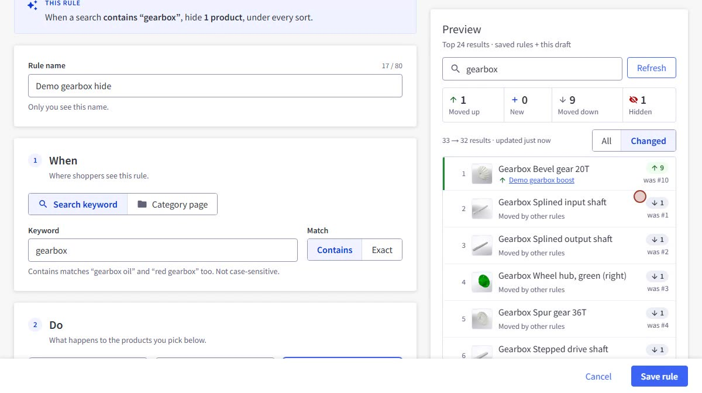

---

## Turn Rules On and Off, Edit or Delete

- Use the switch in the **Active** column to turn a rule off without deleting it. You can always turn a rule off, even if one of its target products has since been deleted.
- A scheduled rule shows its next change next to its name: **Starts Nov 20** before it begins, **Ended Nov 30** after it ends (hover for the full date and time). Use the **Status** filter — **Active**, **Scheduled**, **Ended** or **Paused** — to list only those rules.
- Click the pencil to edit a rule. The **⋯** menu offers **Duplicate**, **Pause** / **Activate** and **Delete**. Before deleting, PapaSearch shows a summary of the rule and offers **Pause the rule instead**.

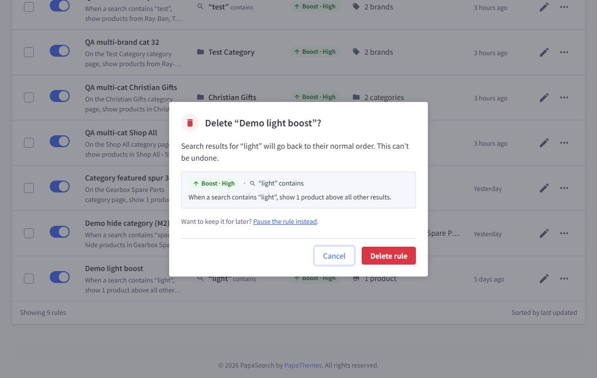

---

## Global Rules

The **Global rules** tab holds three switches that apply to every search and category page of the channel, whatever the shopper types. They are all off until you turn them on.

| Switch | What it does |
|---|---|
| **Bury products without images** | Products with no image move to the end of the results, like a Bury High rule. A product you boost with a rule still stays up. In-stock products without an image still come before out-of-stock products. |
| **Hide products with a zero price** | Products whose price is 0 no longer appear in search results, category pages or filter counts. Products whose price is hidden on BigCommerce are not affected. |
| **Hide products above a price** | Turn it on and enter an amount: products priced above it are hidden. A product priced exactly at the amount stays. The amount uses your store's default currency. |

Under each switch, PapaSearch shows how many products it affects, for example *1,248 products have no image*. Click **Save** to apply; changes reach your storefront within a few minutes. Hiding out-of-stock products, or moving them to the end, stays in **Settings → Products**.

The price used is the one shoppers see: the sale price when there is one, otherwise the calculated price, otherwise the regular price.

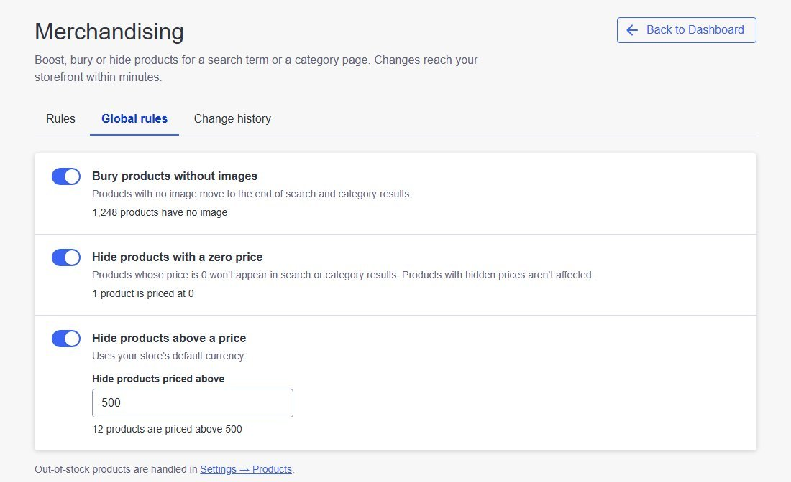

---

## Change History

The **Change history** tab lists every change to your merchandising in the last 30 days, newest first: when it happened, who made it (the email of the BigCommerce user), and what changed. It records creating, editing, pausing, activating and deleting rules, and every save of the global rules, for example:

- *Paused rule “Clearance bury”*
- *Updated rule “Summer boost”: strength high → low; targets 3 items → 5 items*
- *Changed global rules: Hide products above a price 500 → 300*

Click **Load more** to see older changes. Changes older than 30 days are removed automatically.

---

## Good to Know

- Rules apply to the storefront channel you are managing.
- **Whole branch** includes subcategories. Products added while your category list could not be read may not be picked up by a whole-branch rule until they are re-indexed — use **Product Indexes** to re-index them.
- Many stores assign products to a parent category as well as to its subcategories. In that case **This category only** and **Whole branch** reach the same products.
- A product must be in your product index to be used as a target.
